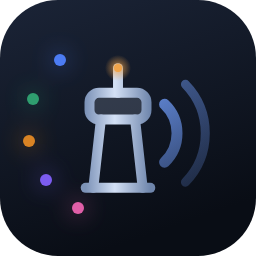

# Agent 空管中心（dsh-atc）

<p align="center">
  
</p>

DeepSeek Harness 的 Agent 空管中心：在**左侧栏**加一行（和「插件」「自动化任务」并列），点开就是全屏面板，一屏看完**本机所有 agent** 正在干什么。

零 token —— 宿主侧只读本地会话存储、纯本地推断状态，不经过任何模型。

## 它解决什么

同时用 DSH / codex / opencode / WorkBuddy / Trae / MiniMax 时，注意力会被切成 N 份。这个插件把「谁在跑、谁停了、谁在等我」压到一屏。

## 数据源

| 工具 | 存储 | 读取方式 |
|---|---|---|
| dsh | `$DSH_HOME/sessions/<workspace>/<session>/session.v4.jsonl.zstd` + `$DSH_HOME/storages/workspace.json` | 目录 mtime + 工作区映射 |
| codex | `~/.codex/sessions/**/rollout-*.jsonl` | 文件 mtime + 头部 `cwd` / `model_provider` |
| opencode | `~/.local/share/opencode/opencode.db` | sqlite（`session` + `message.time_updated`） |
| workbuddy | `~/.workbuddy/workbuddy.db` | sqlite（`sessions.status/last_activity_at`） |
| gemini | `~/.gemini/tmp/<project>/chats/session-*.json` | 每 chat 一个 JSON，mtime + `.project_root` |
| zcode | `~/.zcode/cli/db/db.sqlite` | sqlite（`session` + `message.time_updated`，与 opencode 同构） |
| minimax | `~/.minimax/v2/sqlite/runtime-state.sqlite` | sqlite（`local_runtime_sessions.status/updated_at_ms` + 记录里的 `workspaceDir`） |

读不了的会单独标出来，而不是假装不存在：看板探测 14 个候选工具，**能读的进列表，不能读的进 chip 行的第二段**（悬停显示路径 + 读不了的原因）。目前读不了的是 Trae（`ModularData/ai-agent/database.db` 是 SQLCipher 加密库）、Claude Code（这台机器上没有 `~/.claude/projects/` 会话目录）、Qoder（未安装）。任何一个源失败只降级该源，不影响整板。

## 读不了的 agent，为什么，以及有没有办法

| 工具 | 现状 | 原因 |
|---|---|---|
| **Trae**（IDE / SOLO） | chip 显示 `trae 已加密` | 会话在 `%APPDATA%\Trae CN\ModularData\ai-agent\database.db`（≈151 MB），文件头不是 `SQLite format 3`，是 **SQLCipher 加密库**；`state.vscdb` 倒能打开，但里面只有主题、模型列表、最近打开路径，没有对话 |
| **Claude Code** | chip 显示 `claude 未接入` | 这台机器只有 `~/.claude` 的 skills/plugins 和 1 kB 的 `.claude.json`（无 `history`），**没有可读的历史**。别的机器上 `~/.claude/projects/<slug>/<uuid>.jsonl` 是明文，可直接接 |
| **Qoder** | 不出现 | 未安装（`~/.qoder`、`%APPDATA%\Qoder`、注册表都没有） |

Trae 有三条路，按「干净程度」排：

1. **装 TRAE CLI（最干净）** —— CLI 2.0（`traex`）把会话写成 `~/.trae/cli/sessions/YYYY/MM/DD/rollout-*.jsonl`，**明文 jsonl**，和现有的 codex 解析器同构。本机没装 CLI，所以还没接；装了就能接。
2. **让 Trae 自己导出** —— 社区 MCP 服务 [`mcp-session-saver`](https://www.npmjs.com/package/mcp-session-saver) 在 Trae 里说一句「保存当前会话」，就把对话按 IDE/日期落成 Markdown。插件再读那个目录即可，**零逆向**。
3. **解密数据库** —— [`Oh-My-Trae/trae-db-decrypt`](https://github.com/Oh-My-Trae/trae-db-decrypt) 做的是进程发现 + 内存扫描拿密钥。能work，但要读进程内存、随 Trae 版本失效、风险自担，**不建议集进插件**。

Trae 官方论坛也确认过这条边界：`database.db` 加密、暂不支持查看，界面只给 Markdown 导出（[1](https://forum.trae.cn/t/topic/52906)、[2](https://forum.trae.cn/t/topic/174212/4)）。

## 界面怎么排

本机能有 500+ 条历史会话，**平铺等于没有信息**。所以整页从「一眼看全貌」开始，再落到「谁在等我」：

```
┌ Agent 空管中心  [本地推断·零 token]        更新于 11:02  [今天|近7天|近30天|全部] [⟳ 刷新]
├ 6 个 KPI：在跑 3 · 等你 0 · 失败 0 · 完成 38 · 本机会话 524 · 接入的 agent 4/4
├ 活跃度（热力图）                │ Agent 分布（环形图 + 占比图例）
├ 状态分布（分段条：在跑 / 完成 / 刚停 / 空闲）
├ 会话 124   [搜索标题、工作区…]   [最近更新 | 按工具 | 按工作区]
│ 全部 agent 124 · dsh 40 · codex 4 · opencode 40 · workbuddy 40 │ 在跑 3 · 完成 38 …
├ ✓ 没有需要你处理的              ← 有事时才出现，且永远在最前
├ ▾ 正在跑 3      opencode 1 · workbuddy 2     ← 卡片网格
├ ▾ 最近动过 7    workbuddy 3 · dsh 3 · opencode 1
└ ▸ 更早 114      点开查看                      ← 默认折叠，展开最多 60 张卡片
```

每个会话是一张卡片：标题 + 相对时间、日期、agent / 工作区标签、状态药丸、上下文占用条。

判据：`needs-you`/`failed` → 第一段；`running` → 第二段；其余按 `recentMinutes` 切「最近动过 / 更早」。组标题上的数字是条数，右边是各工具分布。顶部的「本机共 524 个会话，只取最近 124 个」说明每个源最多取 `perSource` 条。

热力图的周数是算出来的：按当前结果里最早的一条会话撑开（4–10 周），既不留大片空白，也不编造没有的历史。

## 筛选

右上角的时间窗口（今天 / 近 7 天 / 近 30 天 / 全部）作用在**最后活动时间**上；「会话」区可按标题、工作区、agent 搜索；agent 和状态胶囊点一下就是筛选。默认全部时间、全部状态，不藏任何东西；筛完可以「清空筛选」复原。

## 跳转

- **DSH 卡片**：点一下直接切到那个会话（`uiWorkspace.openSession`）
- **其它卡片**：复制该卡片的工作区路径，方便去对应工具里找
- 卡片底部的状态药丸与相对时间来自宿主推断，不代表工具本身在跑

## 为什么没有花费

不做跨 agent 的花费统计。唯一有对账本的是 DSH 自己（`dsh-cost-meter` 的 `ledger.json`），codex / opencode / WorkBuddy 没有可比的记账，把其中一家的钱放进「多 Agent 汇总」会误导，所以这一栏整个去掉了。每行只显示各源**自己真的能提供**的信息（见下方「额度 / 上下文」）。

## 可调参数

宿主每次轮询都会读 `$DSH_HOME/atc.json`（不存在就用默认值），**改完不用重启**：

> 改名之前叫 `fleet-board.json`，仍然兼容：两个文件都存在时以 `atc.json` 为准。

```json
{ "perSource": 40, "runningSeconds": 120, "recentMinutes": 30, "attentionHours": 24 }
```

| 键 | 作用 |
|---|---|
| `perSource` | 每个源最多取多少条（影响「显示 N」） |
| `runningSeconds` | 无自带状态时，多少秒内有动静算「在跑」 |
| `recentMinutes` | 「最近动过 / 更早」的分界 |
| `attentionHours` | 失败态只在这么多小时内算「要你处理」，更早的失败是历史 |

模板见 [atc.example.json](atc.example.json)。

## 状态词典

各源的自带状态按这套规则映射，不猜：

| 原始状态 | 归到 |
|---|---|
| `working` / `active` | 在跑 |
| `error` | 失败（且只在 `attentionHours` 内进「要你处理」） |
| `terminated` | 已停 |
| `completed` / `archived` | 完成 |
| `waiting` / `pending` / `confirm` / `approv` | 等你 |
| 其余 | 按最后活动时间推断 |

## 状态怎么来的

全部宿主侧推断，不调模型：

- 存储自带状态（如 WorkBuddy 的 `sessions.status`）优先，命中 `wait/pending/confirm/approv` → **等你**
- 否则按最后活动时间：< 2 分钟 → **在跑**；< 30 分钟 → **刚停**；更久 → **空闲**

「等你」和「失败」计入 tab 标题上的数字，所以收起时也能看到有几条要处理。

## 额度 / 上下文

每行第二行的小字是各源**实际能提供**的信息，不编造：

| 源 | 显示 | 来源 |
|---|---|---|
| workbuddy | `ctx 25% · 17.3 点` | `session_usage` 的 `used/size` 与 `credit_json` |
| codex | `volcengine` | rollout 头部的 `model_provider` |
| dsh / opencode | 无 | 其存储不提供 per-session 成本 |

## 安装（desktop profile）

```powershell
# 1. 备份
Copy-Item "$env:USERPROFILE\.dsh\profiles\desktop\package.json" `
          "$env:USERPROFILE\.dsh\profiles\desktop\package.json.bak"

# 2. 在 package.json 里加两处
#    dependencies."dsh-atc" = "link:/path/to/dsh-atc"
#    dsh.profile.bundles 追加 "dsh-atc"

# 3. 用 runtime 自带 pnpm 装（不要用系统 pnpm）
$rt = "$env:USERPROFILE\.dsh\dsh-runtimes\dsh-primary-runtime\dependencies"
cd "$env:USERPROFILE\.dsh\profiles\desktop"
& "$rt\node\bin\node.exe" "$rt\pnpm\bin\pnpm.cjs" install
```

**必须重启桌面端**：宿主侧插件只在启动时组合进 profile，热加载不生效。

## 使用

左侧栏（和「插件」「自动化任务」并列）会多一行「**空管**」，点开就是面板。图标右上角出现小圆点表示有需要你处理的事。

## 本地开发

```powershell
node scripts/probe.mjs        # 不开 DSH，直接打印面板数据（dry run）
node --test tests/contract.test.mjs   # 宿主路由 + 客户端接线的契约测试
node scripts/render-check.mjs # 用真 React 把真数据渲染成 HTML，产出 render-check.html
node scripts/export-icon.mjs 512 # 把 assets/icon.svg 渲染成透明底 PNG
node --check lib/index.js     # 语法检查
```

改了 `lib/` 要重启桌面端；改了 `client/client.js` 刷新页面即可（link 安装，文件就地生效）。

### 真机无头验证（不碰 desktop profile）

```powershell
# 1. 建一个独立测试 profile（CLI 可管理，desktop 不行）
dsh --profile fleet-test --from-default-profile web --dump-config
dsh plugin --profile fleet-test add "link:/path/to/dsh-atc"

# 2. 起一个独立 web 实例
dsh --profile fleet-test --port 60200 --no-open

# 3. 无头 Edge 打开、点开左侧栏的「空管」、截图
node scripts/live-check.mjs 'http://127.0.0.1:60200/?token=<token>' `
  '--click=空管'
```

`live-check.png` 是当次面板截图，`__dshFleetBoard.registered` 为 true 表示客户端在真宿主里注册成功。

## 卸载

删掉 `package.json` 里那两处，重跑 pnpm install，重启。
