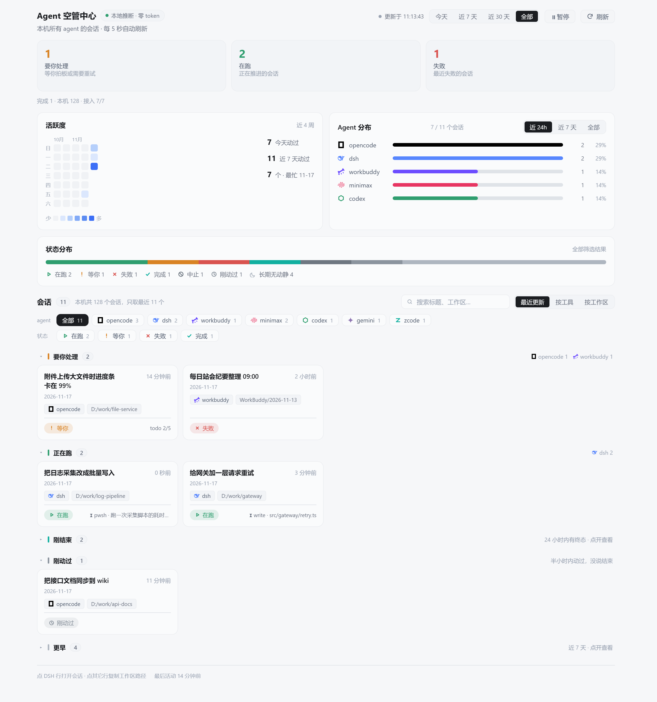

# Agent 空管中心（dsh-atc）

<p align="center">
  
</p>

DeepSeek Harness 的 Agent 空管中心：在**左侧栏**加一行（和「插件」「自动化任务」并列），点开就是全屏面板，一屏看完**本机所有 agent** 正在干什么。

零 token —— 宿主侧只读本地会话存储、纯本地推断状态，不经过任何模型。

```powershell
dsh plugin add dsh-atc
```

装完重启 DSH（宿主侧插件只在启动时组合），左侧栏出现「空管」。



*截图是用**合成数据**渲染的真实组件——布局、图标、分档都是真的，会话标题/工作区/计数全是编的，不来自任何一台机器。*

## 它解决什么

同时用 DSH / codex / opencode / WorkBuddy / Trae / MiniMax 时，注意力会被切成 N 份。这个插件把「谁在跑、谁停了、谁在等我」压到一屏。

## 只读，且路由有宿主同级的准入检查

插件读的全部是本地会话存储，SQLite 一律 `readOnly` 打开，不写任何 agent 的数据，不联网（除同源自己的那条路由），也不调用模型。

那条路由 `/dsh-atc/data` 在 handler 入口先过宿主的准入检查：

```js
connection.requestRejection(request)   // Host/Origin 围栏 + 要求已认证的 live Peer
```

不通过就 403。没有这道检查时，浏览器里任意一个网页都能通过 `http://127.0.0.1:<端口>` 读到本机所有会话的标题和工作区（DNS rebinding / localhost CSRF）——而这个面板恰恰把「谁在干什么」全列出来了。

> 这条是市场维护者合并 PR 时提出的，原始描述里被写进了「HTTP 路由没有 DSH 的访问检查」。

## 数据源

| 工具 | 存储 | 读取方式 |
|---|---|---|
| dsh | `$DSH_HOME/sessions/<workspace>/<session>/session.v4.jsonl.zstd` + `$DSH_HOME/storages/workspace.json` | 目录 mtime + 工作区映射 |
| codex | `~/.codex/sessions/**/rollout-*.jsonl` | 文件 mtime + 头部 `cwd` / `model_provider` |
| opencode | `~/.local/share/opencode/opencode.db` | sqlite（`session` + `message.time_updated`） |
| workbuddy | `~/.workbuddy/workbuddy.db` | sqlite（`sessions.status/last_activity_at`） |
| gemini | `~/.gemini/tmp/<project>/chats/session-*.json` | 每 chat 一个 JSON，mtime + `.project_root` |
| zcode | `~/.zcode/cli/db/db.sqlite` | sqlite（`session` + `message.time_updated`，与 opencode 同构） |
| minimax | `~/.minimax/v2/sqlite/runtime-state.sqlite` | sqlite（`local_runtime_sessions.status/updated_at_ms` + 记录里的 `workspaceDir`） |

读不了的会单独标出来，而不是假装不存在：看板探测 14 个候选工具，**能读的进列表，不能读的进 chip 行的第二段**（悬停显示路径 + 读不了的原因）。任何一个源失败只降级该源，不影响整板。

## 读不了的 agent

探测到但读不了的工具，会在 chip 行末尾以虚线 chip 出现，悬停显示探测到的路径和原因；**可读但为空的源不出现**——空库不代表这个 agent 坏了，没必要占一行。

典型情况是 **Trae**：它的会话存在一个加密数据库里，明文读不到，所以在看板上显示为 `trae 已加密`。

三条解法，按「干净程度」排：

1. **装 TRAE CLI** —— CLI 会把会话写成 `~/.trae/cli/sessions/` 下的明文 jsonl，与控制台现有解析器同构。**解析器已经写好**（`collectTraeCli`），装上 CLI 就会自动出现在列表里。
2. **让它自己导出** —— 社区 MCP 服务 [`mcp-session-saver`](https://www.npmjs.com/package/mcp-session-saver) 可在 IDE 里说一句「保存当前会话」，把对话落成 Markdown，再让看板读那个目录即可，**零逆向**。
3. **解密数据库** —— [`Oh-My-Trae/trae-db-decrypt`](https://github.com/Oh-My-Trae/trae-db-decrypt) 做的是进程发现 + 内存扫描拿密钥。能work，但要读进程内存、随版本失效、风险自担，**不集成进插件**。

同类工具官方也确认过这条边界：加密库暂不支持查看，界面只给 Markdown 导出（[1](https://forum.trae.cn/t/topic/52906)、[2](https://forum.trae.cn/t/topic/174212/4)）。

## 界面怎么排

本机能有 500+ 条历史会话，**平铺等于没有信息**。所以整页从「一眼看全貌」开始，再落到「谁在等我」：

```text
Agent 空管中心  [本地推断·零 token]      更新于 11:02   [今天|近7天|近30天|全部]  [⏸ 暂停][⟳ 刷新]
────────────────────────────────────────────────────────────────────────
 1 要你处理   │  2 在跑   │  1 失败            ← 只有三个行动数字
 完成 39 · 本机 546 · 接入 7/9                ← 库存收成一行小字
────────────────────────────────────────────────────────────────────────
 活跃度（热力图）              │ Agent 分布  26 / 142   [近24h|近7天|全部]
                               │ workbuddy 15 · dsh 8 · opencode 2 · minimax 1
 状态分布（分段条）             │ 在跑 2 · 失败 1 · 完成 39 · 中止 2 · 刚动过 1 · 长期无动静 98
────────────────────────────────────────────────────────────────────────
 会话 142   [搜索标题、工作区…]        [最近更新 | 按工具 | 按工作区]
 agent 全部 142 · dsh 40 · opencode 40 · workbuddy 40 · minimax 14 …
────────────────────────────────────────────────────────────────────────
 ★ 标星 3        你标过的，永远在最上
 ✓ 要你处理 1    有事才出现
 ▾ 正在跑 2
 ▸ 刚结束 15     24 小时内有终态 · 默认折叠
 ▾ 刚动过 1      半小时内动过、没有终态
 ▸ 更早 123      近 7 天 · 点开查看    ← 展开先给一周，底部可「显示全部」
```

每个会话是一张卡片：标题 + 相对时间、日期、agent / 工作区标签、状态药丸、上下文占用条。
右键卡片有菜单：从看板移除 / 标星 / 打开会话 / 复制标题。

两处刻意的口径：

- **顶栏只放行动类数字**。「完成 / 本机会话 / 接入率」是库存，放成一行小字——同一组数字在顶栏、分布条、筛选芯片各报一遍只会稀释注意力。
- **Agent 分布默认按近 24h 统计**，可切近 7 天 / 全部。「全部」比的是谁历史攒得多——几个主力 agent 常常各占一样的份额，齐刷刷并列，说明不了现在谁在干活。

## agent 靠图标区分，不靠颜色

八个色相装不下九个 agent：总有两个撞在一起，色弱用户则一个都分不出。所以每个 agent 用**自己的品牌图标**（DeepSeek 的鲸鱼、Claude 的花、OpenAI 的 knot…），颜色只做冗余补充。

- 品牌图标取自 [simple-icons](https://simpleicons.org)（CC0），由 `scripts/build-brand-icons.mjs` 生成后写进 `client/client.js` 的 `BRAND_ICONS`：**一个 path、一条 24×24 viewBox、一个品牌色**。桌面端不联网，图标全部内联。
- 没有公开图标的工具（codex、zcode…）保留几何记号作回退，**不臆造厂商商标**。
- 同一套图标贯穿全页：筛选胶囊、卡片标签、Agent 分布的排行条、分组标题右侧的 agent 构成，扫一眼就能对上。

状态那一维另有一套**线性记号**（▶ ! ✕ ✓ ⊘ ⏱ 🌙），见「状态词典」。**填充 = 是谁，线条 = 什么状态**，两个维度一眼可分。

环形图因此换成了排行条：九个 agent 挤进一个环就是九条细缝的纯颜色，是最难分辨的形态；排行条里「图标=是谁、条长=多少、颜色=重复一遍」。

## 筛选

右上角的时间窗口（今天 / 近 7 天 / 近 30 天 / 全部）作用在**最后活动时间**上；「会话」区可按标题、工作区、agent 搜索。

筛选胶囊分成**两行**：上面一行是 **agent**（哪些 agent），下面一行是 **状态**（哪些状态）。分两行是因为 agent 的数量随机器增长、状态最多四个，挤在一行时两个维度会互相挤掉，中间那条分隔线一换行就没了。点一下是选中，**再点一下同一个胶囊就取消** —— 选不掉的筛选是坑。各组数字是**分面计数**：算当前这组的分布时，另一组不参与，所以切来切去数字不会变成一片 0。

状态组只给四个值得筛的状态：**在跑 / 等你 / 失败 / 完成**。`刚动过` 和 `长期无动静` 是兜底桶（"最近没动静"），筛它们等于把「更早」那一段再翻一遍，所以不做成胶囊 —— 但卡片上的状态药丸照样显示这两个状态。默认全部时间、全部状态，不藏任何东西；筛完可以「清空筛选」复原。

## 跳转

- **DSH 卡片**：点一下直接切到那个会话（`uiWorkspace.openSession`）
- **其它卡片**：复制该卡片的工作区路径，方便去对应工具里找
- 卡片底部的状态药丸与相对时间来自宿主推断，不代表工具本身在跑

## 为什么没有花费

不做跨 agent 的花费统计。唯一有对账本的是 DSH 自己（`dsh-cost-meter` 的 `ledger.json`），codex / opencode / WorkBuddy 没有可比的记账，把其中一家的钱放进「多 Agent 汇总」会误导，所以这一栏整个去掉了。每行只显示各源**自己真的能提供**的信息（见下方「额度 / 上下文」）。

## 标星与隐藏

- **标星**：点卡片右上角的 ☆（或右键「标星并置顶」），这一条会从状态分档里提到最上面的「标星」分组，不管它现在是完成还是刚停。星存在浏览器本地（`dsh-atc:starred`），磁盘上的数据一个字节都不动。
- **隐藏**：右键「从看板移除」，这条从看板消失，底部出现「已移除 N 条 · 恢复」。同样是显示层，随时可撤回。

顶部三张行动卡的计数**只统计屏幕上剩下的行**，所以隐藏或筛选之后，数字不会和列表打架。

## 发现与自动接入

插件认识的工具写在 `lib/sources.mjs` 里（声明式 spec：哪些表名、哪些列名算「会话库」）。除此之外，宿主启动 12 秒后会在后台遍历一次应用目录，把没见过的库按**内容**打分并匹配 spec：

- 形状完全对上（表名 + id/时间列都在）→ **自动并入看板**，行上标 `自动发现`，不需要你做任何事
- 只是「有张 sessions 表」→ 不并入，也不猜，只在空状态里列为候选
- 文件头不是 SQLite（加密容器）→ 标「读不了」

结果缓存在 `$DSH_HOME/atc-discovered.json`，6 小时过期；轮询（每 5 秒）**从不触发扫描**，只读那 9 条固定路径。

## 可调参数

宿主每次轮询都会读 `$DSH_HOME/atc.json`（不存在就用默认值），**改完不用重启**：

> 改名之前叫 `fleet-board.json`，仍然兼容：两个文件都存在时以 `atc.json` 为准。

```json
{ "perSource": 40, "runningSeconds": 120, "recentMinutes": 30, "attentionHours": 24 }
```

| 键 | 作用 |
|---|---|
| `perSource` | 每个源最多取多少条（影响「显示 N」） |
| `runningSeconds` | 无自带状态时，多少秒内有动静算「在跑」 |
| `recentMinutes` | 「最近动过 / 更早」的分界 |
| `attentionHours` | 失败态只在这么多小时内算「要你处理」，更早的失败是历史 |
| `autoDiscover` | 发现扫描命中已知形状的库时，是否自动并入看板（默认 `true`） |

模板见 [atc.example.json](atc.example.json)。

## DSH 的状态来自日志事件

DSH 的存储里没有状态列，所以它的「在跑 / 完成 / 失败」不看文件时间，而是读会话日志里最后那一对事件：

```
turn/start           → 有未结束的轮次 ⇒ 在跑
turn/end.reason.kind → completed / error / aborted / approval / …
```

映射：`approval|blocked` → 等你，`error` → 失败，`aborted|interrupted` → 已停；`completed` 只表示「这一轮结束了」，所以按时间衰减成刚停 / 无动静，不会一直挂着「在跑」。

代价是每次会话有写入时要多解一小段日志尾部（倒退最多 24 帧就停），并且按 mtime 记忆 —— 40 个会话冷启 270 ms、热 23 ms。

## 状态词典

每个状态有自己的记号，和 agent 的品牌图标分开：**填充的品牌图标 = 是谁，线性描边的记号 = 什么状态**。颜色只是第三重冗余，色弱用户靠形状也能分清。

| 状态 | 记号 | 含义 |
|---|---|---|
| 在跑 | ▶ | 存储自带 `running/active`，或刚刚还有动静 |
| 等你 | ! | 存储自带 `wait/pending/confirm/approv` —— 在等你拍板 |
| 失败 | ✕ | 存储自带 `error`，且是最近才失败的 |
| 完成 | ✓ | 存储自带 `completed/archived` —— 归档的会话也算完成 |
| 中止 | ⊘ | 存储自带 `terminated/cancel/stop/aborted` |
| 刚动过 | ⏱ | 半小时内动过，但存储没说它结束 —— 这是时间，不是终态 |
| 长期无动静 | 🌙 | 半小时以上没动，存储也没说它结束 —— 不代表已归档 |

各源的自带状态按这套规则映射，不猜：

| 原始状态 | 归到 |
|---|---|
| `working` / `active` | 在跑 |
| `error` | 失败（且只在 `attentionHours` 内进「要你处理」） |
| `terminated` | 中止 |
| `completed` / `archived` | 完成 |
| `waiting` / `pending` / `confirm` / `approv` | 等你 |
| 其余 | 按最后活动时间推断 |

**「长期无动静」不是归档。** 它是兜底状态：该存储没有自带状态、而且已经很久（默认 > `recentMinutes` = 30 分钟）没有任何动静。真正归档的会话，如果存储自带 `archived`，会落在**完成**里；存储不给状态、只是很久没动的，就落在**长期无动静**。每个状态药丸都有 tooltip 说明它是怎么来的。

## 状态怎么来的

全部宿主侧推断，不调模型：

- 存储自带状态（如 WorkBuddy 的 `sessions.status`）优先，命中 `wait/pending/confirm/approv` → **等你**
- 否则按最后活动时间：< 2 分钟 → **在跑**；< 30 分钟 → **刚停**；更久 → **无动静**

「等你」和「失败」计入 tab 标题上的数字，所以收起时也能看到有几条要处理。

## 额度 / 上下文

每行第二行的小字是各源**实际能提供**的信息，不编造：

| 源 | 显示 | 来源 |
|---|---|---|
| workbuddy | `ctx 25% · 17.3 点` | `session_usage` 的 `used/size` 与 `credit_json` |
| codex | `volcengine` | rollout 头部的 `model_provider` |
| dsh / opencode | 无 | 其存储不提供 per-session 成本 |

## 下一步

按价值和依赖排的，不是承诺：

| 方向 | 要做什么 | 代价 |
|---|---|---|
| **点卡片直接跳到对应工具** | 现在只有 DSH 行能跳（`uiWorkspace.openSession`），其它 agent 点击是复制工作区路径。目标是每张卡片都落到「那个工具里的这条会话」，例如 opencode 用 `opencode --session <id>`、WorkBuddy 走它的 deep link。缺的是各家「打开某会话」的入口，要逐个确认能不能从外部唤起 | 中 |
| **卡片详情抽屉** | 点开看最近几条消息、tool 调用、耗时。前置是 `tool/call` 事件解析——那同时也是「在跑卡显示正在干什么」的前提，一次做完两件事 | 大 |
| **spec 引擎取代手写 collector** | sqlite 系仍是四个手写采集器，`lib/sources.mjs` 目前只用于匹配。改成走 `lib/generic.mjs` 的通用查询，能删掉约 150 行重复代码 | 中 |
| **接入扫描到的候选** | 本机扫描已经能识别 AionUi、GitKrakenCLI 这类「有会话表但没 spec」的库，缺的只是一行 spec | 小 |

## 开发与发布工具

都在 `scripts/` 下，都不需要起 DSH（除 `live-check`）：

| 命令 | 作用 |
|---|---|
| `npm run preview` | 用**合成数据**渲染真实组件并截图，产出 `docs/preview-board.png`（README 顶部那张）。布局/图标是真的，会话内容全是编的——所以不需要打码，也不可能漏 |
| `npm run sync-mirror` | 把 npm 发布产物原样镜像到 gitcode 同步仓：取 `dist.tarball`、校验 sha512、生成目录 README 与索引行。详见 [PUBLISHING.md](PUBLISHING.md) |
| `npm run scan-agents` | 扫本机应用目录，报每个库的形状、体量和匹配到的 spec。`lib/discover.mjs` 是同一套逻辑的运行时版本 |
| `npm run render-check` / `npm run empty-check` | 离线渲染校验：一个是真实数据下的整页，一个是零会话时的空状态（含「按钮不许回来」的反向断言） |
| `npm run live-check` | 真机无头浏览器：点开侧栏「空管」、按 aria 标签点控件、截图、抓 console 异常 |
| `npm run check` | 语法 + 品牌图标是否与 simple-icons 同步 |

## 安装

### 从 npm（推荐）

```powershell
dsh plugin add dsh-atc
```

桌面端也可以在「插件 → 添加插件」里填 `dsh-atc`。

装指定版本：

```powershell
dsh plugin add dsh-atc@0.16.0
```

### 从 GitHub（npm 不可用时）

```powershell
dsh plugin add github:littleyellowbicycle/dsh-atc#v0.16.0
```

这条不需要 npm，但首次安装会走一次源码构建，需要放行构建脚本。

### 从本地源码

用来改代码，改动会立刻生效（`lib/` 需重启，`client/` 刷新页面即可）：

```powershell
dsh plugin add "link:/path/to/dsh-atc"
```

或者手改 profile 的 `package.json`，把 `dependencies."dsh-atc"` 指向本地路径、`dsh.profile.bundles` 里追加 `"dsh-atc"`，然后用 DSH runtime 自带的 pnpm 安装（不要用系统 pnpm，版本不匹配会报 lockfile 错误）：

```powershell
$rt = "$env:USERPROFILE\.dsh\dsh-runtimes\dsh-primary-runtime\dependencies"
cd "$env:USERPROFILE\.dsh\profiles\desktop"
& "$rt\node\bin\node.exe" "$rt\pnpm\bin\pnpm.cjs" install
```

> desktop profile 由桌面应用独占管理，CLI 的 `dsh plugin` 命令不能改它——桌面端请走「插件」页面。

### 装完必须重启桌面端

宿主侧插件只在启动时组合进 profile，热加载不生效。只改了 `client/` 的话，刷新页面就够。

## 使用

左侧栏（和「插件」「自动化任务」并列）会多一行「**空管**」，点开就是面板。图标右上角出现小圆点表示有需要你处理的事。

### 侧栏那枚塔按宿主的重量画

侧栏图标不是随手画的。宿主在 16px 画布上用 2px 描边画自己的图标：时钟 75px 墨迹、旋翼 81px、面板 121px，落点都在 14–16px 之间。这枚塔按同一份规格画——占满画布、描边同重、墨迹摊到整个宽度（98px / 16×15）。

早先那版是把画在 24×24 里的塔整体放大 1.42 倍：墨迹全挤成左边 8px 宽的一团，右边两道电波只剩 1px 淡线——所以站在「插件」「自动化任务」旁边就是显小。

16px 下**只留一道电波**：两道同心弧加上塔，描边之间挤不出白缝，会糊成一团；一道粗弧既读得出广播，也撑得住画布右半边。右上角的琥珀小点从 5px 收到 2.7px——之前它比塔本身还抢眼。

`scripts/icon-lab.html` 是量这件事的工具：把候选图形按 16px 栅格化，和宿主图标的真实像素并排比墨迹面积与落点。

## 本地开发

```powershell
node scripts/probe.mjs        # 不开 DSH，直接打印面板数据（dry run）
node --test tests/contract.test.mjs   # 宿主路由 + 客户端接线的契约测试
node scripts/render-check.mjs # 用真 React 把真数据渲染成 HTML，产出 render-check.html
node scripts/export-icon.mjs 512 # 把 assets/icon.svg 渲染成透明底 PNG
node scripts/audit-privacy.mjs # 发布前脱敏自查（非零退出即不合格）
node --check lib/index.js     # 语法检查
```

`npm publish` 前会自动跑 `check → test → audit:privacy`（`prepublishOnly`）。脱敏自查拦三类东西：**绝对路径**（含当前用户的 home 目录）、**一次性观察**（文件体量、文件头、表名这类只对某台机器成立的细节）、**疑似密钥与个人邮箱**。

改了 `lib/` 要重启桌面端；改了 `client/client.js` 刷新页面即可（link 安装，文件就地生效）。

### 真机无头验证（不碰 desktop profile）

```powershell
# 1. 建一个独立测试 profile（CLI 可管理，desktop 不行）
dsh --profile fleet-test --from-default-profile web --dump-config
dsh plugin --profile fleet-test add "link:/path/to/dsh-atc"

# 2. 起一个独立 web 实例
dsh --profile fleet-test --port 60200 --no-open

# 3. 无头 Edge 打开、点开左侧栏的「空管」、截图
node scripts/live-check.mjs 'http://127.0.0.1:60200/?token=<token>' `
  '--click=空管'
```

`live-check.png` 是当次面板截图，`__dshFleetBoard.registered` 为 true 表示客户端在真宿主里注册成功。

## 卸载

```powershell
dsh plugin remove dsh-atc
```

然后重启 DSH。桌面端在「插件」页面里移除。

从本地源码装的话，删掉 profile `package.json` 里 `dependencies` 和 `bundles` 这两处，重跑 pnpm install，再重启。
